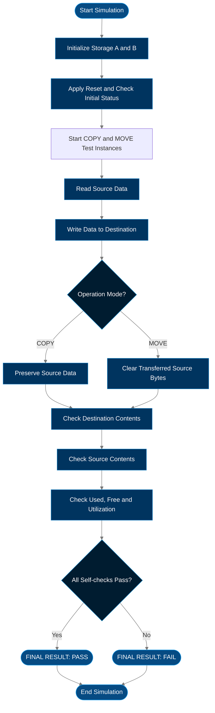

# Day 22 — Hierarchical Memory COPY/MOVE Controller

<p align="center">
  **Digital VLSI • Verilog RTL • Hierarchical Design • Memory Transfer • Cadence Genus**
</p>

<p align="center">
  `Specification → RTL → Testbench → Simulation → Synthesis → Area → Power → Timing → PPA Review`
</p>

<p align="center">
  
  
  
  
</p>

---

## 1. Project Information

| Parameter | Details |
|---|---|
| **Project** | Hierarchical Memory COPY/MOVE Controller |
| **Author** | Omkar Kalmesh Hadapad |
| **Domain** | Digital VLSI / RTL Design / Functional Verification |
| **Design Type** | Hierarchical memory-transfer controller |
| **HDL** | Verilog HDL |
| **Logical Storage Model** | Two banks, A and B; each 64 bytes × 8 bits in simulation |
| **Top Module** | `day22_top` |
| **Hierarchy** | `day22_top` → `day22_memory_subsystem` → `copy_move_controller` |
| **Submodules** | `address_counter`, `transfer_fsm` |
| **Simulation Tool** | Cadence NC-Sim |
| **Synthesis Tool** | Cadence Genus 21.14-s082_1 |
| **Technology Library** | `tsmc18` |
| **Operating Condition** | `slow (balanced_tree)` |
| **Wireload Mode** | `enclosed` |
| **Reported Functional Result** | PASS — COPY AND MOVE VERIFIED |
| **Self-check Errors** | 0 |
| **Simulation Completion** | `$finish` at 1087 ns |
| **Synthesis Cell Count** | 60 standard-cell instances |
| **Reported Cell Area** | 1333.886 library area units |
| **Estimated Total Power** | 104.955 µW |
| **Timing Status** | One reported setup path MET, +6.748 ns slack |
| **Physical Design Status** | Post-route PPA closure not established |

> **Measurement note:** The area unit has not been confirmed as µm². Power is an estimate associated with activity frame `/stim#0/frame#0`. The timing report uses synthesis wireload-mode analysis. The supplied reports do not establish routed, extracted-parasitic PPA closure. The synthesized memory implementation still requires confirmation.

---

## 2. Project Overview

This project implements a hierarchical controller that transfers data between two logical storage banks.

- **COPY:** transfers selected source data to the destination while preserving the source.
- **MOVE:** transfers selected source data to the destination and clears the transferred source bytes.
- A finite-state machine (FSM) sequences the transfer.
- An address counter tracks the transfer position.
- The testbench checks destination data, source retention/clearing, and storage-utilization values.

The supplied NC-Sim transcript reports that the COPY and MOVE scenarios completed successfully, with zero self-check errors and simulation termination at 1087 ns.

The project covers hierarchical RTL, FSM/counter integration, memory-transfer control, self-checking simulation, synthesis hierarchy, standard-cell area, estimated power, setup timing and checking that intended memory behavior is retained after synthesis.

---

## 3. Objectives

1. Design a hierarchical memory-transfer controller in Verilog.
2. Separate transfer sequencing from address counting.
3. Support COPY and MOVE modes.
4. Verify destination data ordering.
5. Verify COPY source preservation.
6. Verify MOVE source clearing for transferred bytes only.
7. Check used-byte, free-byte and utilization calculations.
8. Run self-checking simulation and inspect waveforms.
9. Synthesize using Cadence Genus.
10. Review hierarchy and mapped standard-cell area.
11. Interpret internal, switching and leakage power.
12. Review the reported setup path.
13. Confirm how storage is represented in the synthesized netlist.
14. Identify evidence required for full timing and physical-design closure.

---

## 4. Architecture and Verification Flow

The simulation model uses two logical storage banks, A and B, each with 64 byte locations.



**Reported verification result**
- Self-check errors: **0**
- Final result: **PASS — COPY AND MOVE VERIFIED**
- Simulation completion: **1087 ns**

The flowchart is a conceptual overview of the reported test scenario, not the actual RTL state-transition diagram.

### Conceptual block diagram

```text
                       day22_top
                           |
                           v
                day22_memory_subsystem
                           |
                           v
                  copy_move_controller
                     /           \
                    v             v
              transfer_fsm   address_counter
                    |             |
                    +------+------+
                           |
                 Transfer control and
                  address sequencing
                           |
                 +---------+---------+
                 |                   |
                 v                   v
             Storage A            Storage B
              64 × 8                64 × 8
```

This is a conceptual functional view. The exact storage implementation and connectivity in the synthesized netlist must be confirmed separately.

### Reported synthesis hierarchy

```text
day22_top
└── u_subsystem (day22_memory_subsystem)
    └── u_controller (copy_move_controller)
        ├── u_counter (address_counter)
        └── u_fsm (transfer_fsm)
```

| Instance | Module | Function indicated by name |
|---|---|---|
| `u_subsystem` | `day22_memory_subsystem` | Memory-transfer subsystem |
| `u_controller` | `copy_move_controller` | COPY/MOVE control |
| `u_counter` | `address_counter` | Address/count progression |
| `u_fsm` | `transfer_fsm` | Transfer state sequencing |

The hierarchy report does not list a separate memory module. This alone does not prove that storage was removed; inspect elaboration reports and the mapped netlist before drawing that conclusion.

---

## 5. Storage Model and Initial Contents

| Bank | Initial contents | Occupied bytes | Free bytes | Utilization |
|---|---|---:|---:|---:|
| Storage A | Uppercase `Z`…`A` at addresses 0–25; lowercase `z`…`a` at 26–51 | 52 | 12 | 81.25% |
| Storage B | Empty | 0 | 64 | 0.00% |

The uppercase sequence is stored in reverse address order:

- `Z` is at source address `0x00`.
- `A` is at source address `0x19` (decimal 25).
- The transfer reads addresses `0x19` down to `0x00`, writing `A` through `Z` to destination addresses `0x00` through `0x19`.

Storage A addresses 52–63 begin empty.

---

## 6. COPY and MOVE Operation

### COPY mode

| Requirement | Expected behavior |
|---|---|
| Source range | Storage A addresses 0–25 |
| Destination range | Storage B addresses 0–25 |
| Data transferred | Uppercase `A`–`Z` |
| Source after transfer | Uppercase and lowercase contents retained |
| Final Storage A | 52 used, 12 free, 81.25% utilization |
| Final Storage B | 26 used, 38 free, approximately 40.62% utilization |

### MOVE mode

| Requirement | Expected behavior |
|---|---|
| Source range | Storage A addresses 0–25 |
| Destination range | Storage B addresses 0–25 |
| Data transferred | Uppercase `A`–`Z` |
| Source after transfer | Uppercase bytes cleared; lowercase bytes retained |
| Final Storage A | 26 used, 38 free, approximately 40.62% utilization |
| Final Storage B | 26 used, 38 free, approximately 40.62% utilization |

For 26 of 64 locations, the exact utilization is 40.625%; the transcript may display 40.62% depending on formatting.

```text
Start request
    |
    v
Select COPY or MOVE
    |
    v
FSM sequences transfer; counter tracks addresses
    |
    v
Read source byte → write destination byte
    |
    +-------------------------+
    |                         |
    v                         v
COPY: preserve source     MOVE: clear transferred
                          source byte
    |                         |
    +------------+------------+
                 |
                 v
          Update status / finish
```

Exact handshake, cycle count and state encoding depend on the RTL.

---

## 7. Functional Verification

### Reported NC-Sim results

| Check | Reported result |
|---|---|
| Initial Storage A occupancy | PASS |
| Initial Storage B empty state | PASS |
| Initial free-space/utilization values | PASS |
| Independent initialization of COPY and MOVE DUT instances | PASS |
| Concurrent COPY and MOVE starts | Executed |
| MOVE completes before timeout | PASS |
| MOVE destination contains uppercase `A`–`Z` | PASS |
| MOVE clears uppercase source bytes | PASS |
| MOVE preserves lowercase source bytes | PASS |
| COPY destination contains uppercase `A`–`Z` | PASS |
| COPY preserves source contents | PASS |
| Final readbacks | Match expected values |
| Self-check error count | **0** |
| Final result | **PASS — COPY AND MOVE VERIFIED** |
| Simulation completion | **1087 ns** |

### Final storage status

| Operation | Storage A used | Storage A free | Storage A utilization | Storage B used | Storage B free | Storage B utilization |
|---|---:|---:|---:|---:|---:|---:|
| COPY | 52 | 12 | 81.25% | 26 | 38 | ≈40.62% |
| MOVE | 26 | 38 | ≈40.62% | 26 | 38 | ≈40.62% |

COPY and MOVE results refer to separate DUT instances in the testbench. They should not be interpreted as sequential operations on one shared memory pair unless the RTL/testbench explicitly implements that arrangement.

### Verification limitations

The transcript verifies the scenarios and checks shown. It does not establish exhaustive correctness for every address range, overlapping source/destination range, reset timing, simultaneous request, error condition or timeout scenario. Add tests for these cases if they are part of the specification.

---

## 8. Genus Synthesis Results

| Metric | Reported value |
|---|---:|
| Top module | `day22_top` |
| Standard-cell instances | **60** |
| Total reported cell area | **1333.886 library area units** |
| Technology library | `tsmc18` |
| Operating condition | `slow (balanced_tree)` |
| Wireload mode | `enclosed` |
| Synthesis tool | Cadence Genus 21.14-s082_1 |

These are synthesis-stage results. They do not establish placement, routing or extracted-parasitic timing closure.

---

## 9. Standard-Cell Mapping and Area Analysis

### Area by cell category

| Category | Instances | Reported area | Reported share |
|---|---:|---:|---:|
| Sequential | 10 | 711.850 | 53.4% |
| Inverter | 11 | 73.181 | 5.5% |
| Logic | 39 | 548.856 | 41.1% |
| Physical cells | 0 | 0.000 | 0.0% |
| **Total** | **60** | **1333.886** | **100.0%** |

### Selected mapped cells

| Standard cell | Instances | Reported area |
|---|---:|---:|
| `DFFRHQX1` | 9 | 628.690 |
| `SDFFRHQX1` | 1 | 83.160 |
| `NAND2X1` | 11 | 109.771 |
| `OAI211X1` | 4 | 79.834 |
| `INVX1` | 6 | 39.917 |
| `INVXL` | 5 | 33.264 |

### Interpretation

- Sequential cells account for **53.4%** of reported area.
- Nine `DFFRHQX1` instances are the largest individual cell group in the supplied cell report.
- Combinational logic accounts for **41.1%**; inverters account for **5.5%**.
- `Net Area = 0` is not evidence that interconnect has no physical area; this is not a routed geometry report.

### Hierarchical area observations

| Hierarchy block | Cell count | Reported area |
|---|---:|---:|
| `u_subsystem` / `day22_memory_subsystem` | 60 | 1333.886 |
| `u_controller` / `copy_move_controller` | 60 | 1333.886 |
| `u_counter` / `address_counter` | 32 | 748.440 |
| `u_fsm` / `transfer_fsm` | 7 | 89.813 |

Parent rows are hierarchy summaries and must not be added together. The counter and FSM figures are sub-block contributions, not extra area beyond the top-level total.

The remainder after subtracting the counter and FSM areas from the top-level area is 495.633 area units. This is a calculated remainder, not a separately named block in the supplied report.

The address counter is a significant area contributor. Inspect its RTL and mapped logic before proposing changes. Also confirm whether storage was retained, mapped into standard cells, inferred as memory, or optimized away.

---

## 10. Power Analysis

The supplied report is for:

```text
Instance: /day22_top
Power Unit: W
PDB Frame: /stim#0/frame#0
```

### Power by category

| Category | Total power | Share |
|---|---:|---:|
| Register | 80.1156 µW | 76.33% |
| Logic | 17.0183 µW | 16.21% |
| Clock | 7.82071 µW | 7.45% |
| Memory | 0 W | 0.00% |
| Latch | 0 W | 0.00% |
| Bbox / Pad / PM | 0 W | 0.00% |
| **Subtotal** | **104.955 µW** | **≈100%** |

### Internal, switching and leakage power

| Component | Reported power | Share of subtotal |
|---|---:|---:|
| Internal | 84.7174 µW | 80.72% |
| Switching | 20.1992 µW | 19.25% |
| Leakage | 0.0379694 µW | 0.04% |
| **Subtotal** | **104.955 µW** | **100% approximately** |

### Interpretation

- Register-category power dominates at **80.1156 µW**.
- Logic contributes **17.0183 µW**.
- Clock switching contributes **7.82071 µW**.
- Internal power is the largest component.
- Switching power depends on signal activity and capacitive loading.
- Leakage is a very small fraction of the displayed total.

### Memory-power caveat

The report assigns **0 W** to the separate memory category. This does not prove memory functionality is absent: storage may be represented as registers or logic, or may have been optimized or excluded by the synthesis setup. Since the simulation model has two logical banks but the synthesis summary contains only 60 cells, inspect the elaborated design, memory-inference reports and mapped netlist before concluding that storage is implemented correctly in hardware.

This is a synthesis-stage estimate tied to the specified PDB frame and its activity assumptions. Confirm that activity represents meaningful COPY/MOVE operation. Do not present this result as measured silicon power or post-route power.

---

## 11. Timing Analysis

The supplied setup timing report contains this path:

| Timing item | Reported value |
|---|---|
| Path status | **MET** |
| Setup slack | **+6748 ps ≈ +6.748 ns** |
| Launch point | `u_subsystem/u_controller/u_counter/count_reg[5]/CK` |
| Endpoint | `u_subsystem/u_controller/u_counter/count_reg[5]/D` |
| Capture clock edge | 10,000 ps (10 ns) |
| Setup time | 353 ps |
| Clock uncertainty | 1,000 ps |
| Required time | 8,647 ps |
| Data arrival time | 1,900 ps |
| Data path delay | 1,900 ps |

### Reported data path

```text
count_reg[5]/CK
       |
       v
    DFFRHQX1
       |
       v
    NAND4BBX1
       |
       v
     NOR3X1
       |
       v
     NOR3X1
       |
       v
      INVX1
       |
       v
     AOI22X1
       |
       v
     NOR2X1
       |
       v
count_reg[5]/D
```

One `NOR3X1` stage is reported with 809 ps delay, fanout 7 and load 29.1 fF.

### Interpretation

- The displayed setup path is marked **MET** and has positive slack.
- It meets its requirement under the stated synthesis timing assumptions.
- Arithmetic using rounded fields can differ by 1 ps from the reported slack.
- The report uses wireload-mode analysis, not routed parasitics.
- One MET path does not prove all setup and hold paths meet timing.

The rough expression `10 ns − 6.748 ns ≈ 3.252 ns` is not a validated maximum operating period or frequency. Review full constraints, WNS/TNS, setup and hold paths, and post-route timing before claiming timing closure.

---

## 12. Recommended Optimization Plan

| Priority | Investigation | Reason |
|---|---|---|
| 1 | Confirm memory inference and mapped connectivity | The hierarchy report does not list a separate memory module. |
| 2 | Inspect the address counter | It accounts for 748.440 reported area units. |
| 3 | Review sequential logic and register enables | Sequential cells contribute 53.4% of area; register power dominates. |
| 4 | Validate power activity assumptions | Power is associated with `/stim#0/frame#0`. |
| 5 | Review FSM and transfer-control logic | Preserve COPY/MOVE sequencing and status behavior. |
| 6 | Re-run simulation after RTL changes | Confirm source retention/clearing and destination data. |
| 7 | Re-run Genus with identical settings | Enables valid before/after PPA comparisons. |
| 8 | Run physical implementation and extracted analysis if required | Needed for post-route PPA claims. |

Do not remove required state or change reset, source-clearing or transfer behavior solely to reduce area or power. Any optimization must be supported by updated functional and PPA results.

---

## 13. Overall PPA Summary

| Metric | Result | Qualification |
|---|---:|---|
| Functional simulation | PASS, 0 self-check errors | Supplied NC-Sim transcript |
| Simulation completion | 1087 ns | `$finish` shown |
| Mapped cell count | 60 | Genus synthesis report |
| Reported cell area | 1333.886 area units | Physical unit not confirmed |
| Estimated total power | 104.955 µW | Activity-frame-based estimate |
| Largest area category | Sequential | 711.850 area units |
| Largest power category | Register | 80.1156 µW |
| Reported setup slack | +6.748 ns | One setup path |
| Reported path status | MET | Not proof of all-path closure |
| Synthesized memory implementation | Requires confirmation | Inspect elaborated design and mapped netlist |
| Post-route PPA closure | Not established | No routed/extracted report supplied |

---

## 14. Suggested Repository Structure

```text
day22-hierarchical-memory-copy-move/
├── README.md
├── rtl/
│   ├── day22_top.v
│   ├── day22_memory_subsystem.v
│   ├── copy_move_controller.v
│   ├── address_counter.v
│   └── transfer_fsm.v
├── tb/
│   └── day22_tb.v
├── sim/
│   ├── simulation.log
│   └── waves.shm/
├── genus/
│   ├── constraints.sdc
│   ├── synthesis.tcl
│   ├── mapped_netlist.v
│   └── reports/
│       ├── hierarchy.rpt
│       ├── area.rpt
│       ├── cell_area.rpt
│       ├── power.rpt
│       └── timing.rpt
├── images/
│   ├── memory_copy_move_flow.png
│   ├── simulation_pass.png
│   ├── area_distribution.png
│   ├── power_distribution.png
│   └── timing_path.png
└── docs/
    └── ppa_analysis.md
```

This is a suggested layout. Keep only files that exist in the repository and update filenames to match the actual source files and reports.

---

## 15. Industry Relevance

This project practices concepts relevant to:

- Hierarchical Verilog RTL design.
- FSM and counter integration.
- Data-transfer sequencing and memory-interface control.
- Self-checking testbench construction.
- Functional simulation and waveform debugging.
- Synthesis hierarchy and standard-cell mapping.
- Area and power report interpretation.
- Setup timing analysis.
- Checking whether intended RTL behavior survives synthesis.

Similar control patterns appear in DMA engines, packet/data buffers, embedded subsystems and SoC control paths. This is a learning project; do not describe it as production DMA or verified memory IP without further implementation and validation evidence.

---

## 16. Interview Questions

1. What is the hardware-level difference between COPY and MOVE?
2. Why separate the FSM from the address counter?
3. How does the controller determine transfer completion?
4. What should happen if a new start request arrives while busy?
5. How would you verify that COPY preserves all source bytes?
6. How would you verify that MOVE clears only transferred bytes?
7. Why are COPY and MOVE tested in separate DUT instances?
8. What does a hierarchy report tell you—and what does it not tell you?
9. Does `memory = 0 W` prove that memory logic is absent?
10. Why can RTL simulation pass while synthesis still has a problem?
11. What is the difference between internal, switching and leakage power?
12. Why do sequential cells contribute significantly to area?
13. What does positive setup slack mean?
14. Why is one MET path insufficient to claim full timing closure?
15. What additional reports are needed for post-route PPA closure?

---

## 17. Project Status

| Stage | Status |
|---|---|
| COPY/MOVE functional simulation | PASS for reported scenarios |
| Self-check summary | 0 errors |
| Source retention/clearing checks | PASS in supplied transcript |
| Destination readback checks | PASS in supplied transcript |
| Hierarchy report | Reviewed |
| Standard-cell area report | Reviewed |
| Power report | Reviewed |
| One setup timing path | MET |
| Memory inference/mapped implementation | Requires confirmation |
| Full setup/hold timing closure | Not established |
| Post-route PPA | Not established |

---

## 18. Final Results

| Parameter | Result |
|---|---:|
| Top module | `day22_top` |
| Mapped standard cells | 60 |
| Reported cell area | 1333.886 area units |
| Estimated total power | 104.955 µW |
| Reported setup slack | +6.748 ns |
| Simulation result | PASS — COPY AND MOVE VERIFIED |
| Self-check errors | 0 |
| Simulation finish time | 1087 ns |

**Conclusion:** The supplied simulation transcript verifies the documented COPY and MOVE scenarios. The available Genus reports provide an initial synthesis-stage view of hierarchy, standard-cell area, power and one setup path. The next critical step is to confirm that the synthesized netlist retains the intended storage and transfer behavior. Full timing closure and post-route PPA have not been established by the supplied reports.

---

## 19. Author

**Omkar Kalmesh Hadapad**  
Electronics and Communication Engineering  
Digital VLSI • Verilog RTL • Cadence Genus

---

**Day 22 — Hierarchical Memory COPY/MOVE Controller · Functional Verification and Genus PPA Analysis**
